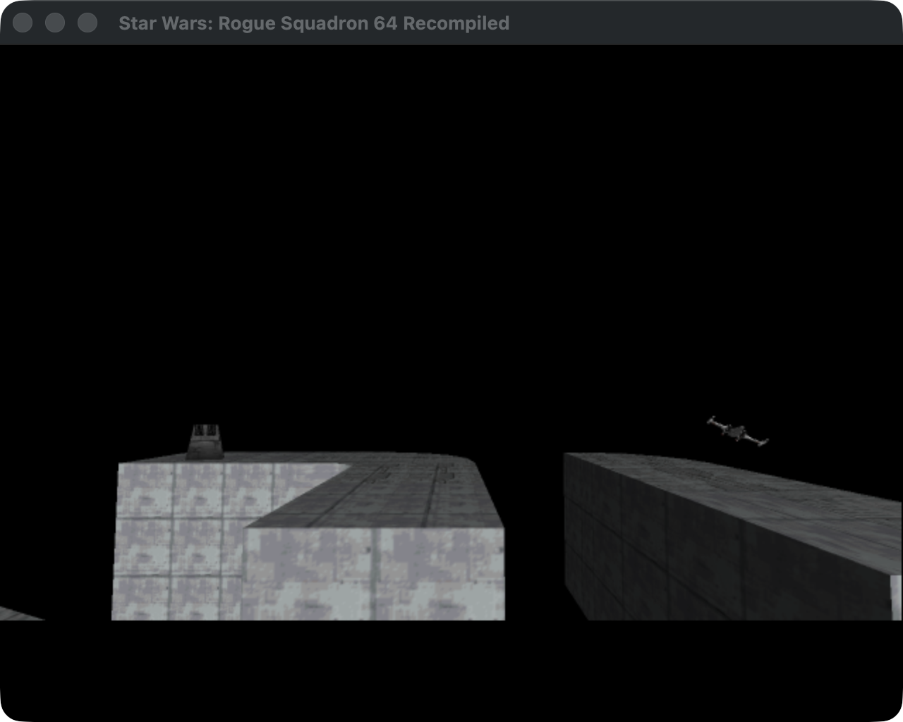

<div align="center">
  

   Icon created by [thedoctor45 on DeviantArt](https://www.deviantart.com/thedoctor45/art/Star-Wars-Rogue-Squadron-3D-Custom-Icon-535469296)

# Star Wars: Rogue Squadron 64 Recompiled (macOS)

</div>

<p align="center"></p>

A static recompilation of **Star Wars: Rogue Squadron** (N64, USA v1.0) that runs natively on macOS, built with [N64Recomp](https://github.com/N64Recomp/N64Recomp), [N64ModernRuntime](https://github.com/N64Recomp/N64ModernRuntime) and [RT64](https://github.com/rt64/rt64).

**Status: the full campaign is playable.** All 19 levels can be played from the intro through the final mission without crashes. Audio works, graphics run through a recompiled copy of Factor 5's own microcode (low-level emulation), and the remaining graphical issues are minor (see [Known issues](#known-issues)).

This is a fork of [MikeSemicolonD/RogueSquadron64Recomp](https://github.com/MikeSemicolonD/RogueSquadron64Recomp), which got the project as far as boot and laid the foundations. Everything since then — the boot-to-campaign work, audio, the LLE graphics path, widescreen and 60 fps options — was done in this fork.

> **No game data is included.** You need your own legally obtained ROM of the USA v1.0 cartridge. The build recompiles it on your machine.

> **Built with heavy AI assistance.** Most of the debugging and code in this fork was produced by Claude running as an autonomous development loop (that's what `tools/agent/`, `scratch/` and the very long `PORTING-STATE.md` are). Expect pragmatic workarounds and a lot of env-gated diagnostic scaffolding. Issues and second opinions are welcome.

---

## Requirements

- A Mac on **macOS 11 or later**. Developed and tested on Apple Silicon; Intel Macs are untested. Windows and Linux are not supported in this fork.
- **Full Xcode** (not just the Command Line Tools) with the **Metal Toolchain** component installed (Xcode > Settings > Components, or `xcodebuild -downloadComponent MetalToolchain`). The shader build needs `xcrun metal`.
- **Homebrew** packages: `brew install cmake ninja sdl2-compat python`
- A **MIPS cross-compiler** (`mips64-elf-gcc`), used to build this project's game-code patches (heap guards, RNG fix). It isn't in Homebrew, so build it once with the included script (takes a while):
  ```bash
  brew install gmp mpfr libmpc gnu-sed
  curl -fsSLO https://raw.githubusercontent.com/fyreatwill/RogueSquadron64Recomp/autonomy/tools/build-mips64-toolchain.sh
  bash build-mips64-toolchain.sh
  export PATH="$HOME/toolchains/mips64-elf/bin:$PATH"
  ```
  Without it the game still builds, but leaves those patches out.
- The **ROM**: Star Wars: Rogue Squadron (USA) v1.0, `.z64` byte order. The game checks the ROM hash on start and tells you if it doesn't match.
- About 5 GB of free disk space (the script checks for more headroom). The build itself takes about 8 minutes on an M-series Mac.

## Building

The build needs three repositories side by side, all from this account:

| Repo | Branch | What it is |
|---|---|---|
| [fyreatwill/RogueSquadron64Recomp](https://github.com/fyreatwill/RogueSquadron64Recomp) | `autonomy` | This project: runtime, patches, build scripts |
| [fyreatwill/N64Recomp](https://github.com/fyreatwill/N64Recomp) | `rs64` | The recompiler, with fixes this game needs |
| [fyreatwill/rogue_squadron64](https://github.com/fyreatwill/rogue_squadron64) | `rs64` | Symbol files from the decompilation, used to split the ROM into functions |

One script does everything: clones the three repos, applies this project's patches to the `lib/` submodules, builds the recompiler, recompiles your ROM into C, post-processes it, and builds the game.

```bash
mkdir rs64 && cd rs64
curl -fsSLO https://raw.githubusercontent.com/fyreatwill/RogueSquadron64Recomp/autonomy/tools/build-from-scratch.sh
zsh build-from-scratch.sh /path/to/your/rogue_squadron.z64
```

When it finishes you'll have `RogueSquadron64Recomp/build/RogueSquadron64Recomp` with your ROM beside it. Logs for each step are in `build-logs/`. Rerunning the script in the same folder reuses what's already there.

The script's last step runs some read-only consistency checks on the generated code. If one of those reports a failure, it prints a warning and keeps going; a failure in any step that builds or edits code stops the script.

What the script does, if you want to do it by hand: clone the three repos side by side, `git submodule update --init --recursive`, run `submodule-patches/apply.sh`, build N64Recomp, run `tools/regen_front.sh` and `tools/regen_replay.sh` to produce `N64Recomp/RecompiledFuncs`, rebuild the Factor 5 microcode with `tools/ucode_regen.sh restore`, then configure and build with CMake. [docs/REGEN-VERIFY.md](docs/REGEN-VERIFY.md) explains the regeneration in detail.

## Running

```bash
cd rs64/RogueSquadron64Recomp/build
./RogueSquadron64Recomp
```

The game uses the folder you run it from as its data folder: the ROM (`rogue_squadron.z64`) goes there, saves go in `saves/`, and settings like the audio device are stored there. The build script already copies your ROM into `build/`.

Default settings are faithful to the original: 4:3, 30 fps, original draw distance. Close the window to quit.

### Controls

Gamepad (Xbox / PlayStation layout via SDL):

| N64 button | Gamepad | Notes |
|---|---|---|
| Stick | Left stick | |
| A | A / Cross | |
| B | X / Square | Fires lasers |
| Z | Left trigger (L2) | |
| R | Right shoulder (R1) | Camera |
| L | Left shoulder (L1) | |
| C-Up | Y / Triangle | |
| C-Down | B / Circle | |
| C-Left | Right trigger (R2), or Back / Share | Secondary weapon |
| C-Right | Left stick click (L3), or Guide / PS | V-wing boost, X-wing wing toggle |
| D-Pad | D-Pad | |
| Start | Start / Options | Pause |

Keyboard: **WASD** stick, **Z** A, **X** B, **C** Z, **Q / E** L / R, **I J K L** C-Up / C-Left / C-Down / C-Right, **arrow keys** D-Pad, **Enter** Start.

Rumble: the game's Rumble Pak effects play on the pad (on by default; `ROGUESQ_RUMBLE=0` turns them off, `ROGUESQ_RUMBLE_SCALE=0..2` sets strength).

Rebinding: press **F6** in game to open the Controls panel. Click **Bind** next to an N64 button and press the pad button, trigger, stick direction or key you want (Esc cancels); **Add** keeps the existing inputs and adds one; **Clear** unbinds; **Reset to defaults** restores the table above; **Save** writes `controls.json` beside the game (loaded at the next start). The game receives no input while the panel is open; F6 or Esc closes it. You can also edit `controls.json` by hand (format in `docs/OWNER-OPT-INS.md`).

Hotkeys: **F6** Controls panel, **F9** cycles the audio output device (remembered in `audio_device.txt`), **Cmd+Ctrl+F** or **Option+Enter** (Alt+Enter) toggles fullscreen. (**F11** is also bound, but macOS gives F11 to its Show Desktop shortcut first, so it only works if you turn that off in System Settings > Keyboard > Keyboard Shortcuts > Mission Control; tested with real key events, s7938.) (RT64's F1 developer overlay has no Metal backend, so it does not open on macOS.)

### Optional settings

Everything beyond the original look is opt-in, set with environment variables on the command line:

```bash
ROGUESQ_FPS60=1 ROGUESQ_ASPECT=16:9 ROGUESQ_FULLSCREEN=1 ./RogueSquadron64Recomp
```

| Variable | Effect |
|---|---|
| `ROGUESQ_FPS60=1` | 60 fps |
| `ROGUESQ_ASPECT=16:9` / `21:9` / `auto` | Widescreen (`auto` matches your screen) |
| `ROGUESQ_FULLSCREEN=1` | Start fullscreen |
| `ROGUESQ_DRAW_DISTANCE=2` (up to `4`) | See terrain further away. `2` is a safe step up; higher values cost performance |
| `ROGUESQ_RDP_ASYNC=1 ROGUESQ_RDP_NODRAIN=3` | Helps hold 60 fps at 16:9 with draw distance 4 |
| `ROGUESQ_RETINA=1` | Render at full Retina resolution |
| `ROGUESQ_WIN_DISPLAY=mouse` | Open on the display the mouse pointer is on |
| `ROGUESQ_AUDIO_DEVICE=<part of name>` | Pick the audio output (overrides the F9 choice) |

A tested "TV" recipe: `ROGUESQ_ASPECT=16:9 ROGUESQ_FULLSCREEN=1 ROGUESQ_FPS60=1 ROGUESQ_DRAW_DISTANCE=2`.

The full list, with what each option was tested against, is in [docs/OWNER-OPT-INS.md](docs/OWNER-OPT-INS.md) and [docs/DRAW-DISTANCE.md](docs/DRAW-DISTANCE.md).

## Known issues

- At draw distance above 1, some terrain can pop in late or drop out for a frame.
- Fixes for these have landed but haven't been play-tested yet, so you may still see them: the hangar coming back with a fish-eye view after you abort a mission, the Factor 5 logo, knife-thin lines in some cutscenes, and the cutscene backgrounds.
- At draw distance 4, the Gerrard V cutscene loses its dark water.
- Performance numbers in the docs were measured on one MacBook Pro. Run on AC power for the smoothest results, and run one copy of the game at a time.

## How it works

Rogue Squadron is a hard target for recompilation: Factor 5 wrote their own graphics and audio microcode, and the engine leans on overlays and unusual MIPS idioms. The short version of what this port does:

- **N64Recomp** turns the game's MIPS code into C, split into functions using the decomp's symbol files. A post-processing step (`tools/regen_replay.sh`) then applies this project's fixes to the generated code.
- **Graphics**: Factor 5's graphics microcode is itself recompiled (RSP recompilation) and runs on the CPU, producing standard display lists that **RT64** renders with Metal.
- **Audio**: Factor 5's MusyX audio microcode is recompiled the same way.
- **Runtime**: `src/main/` contains the platform layer, input, and the game-specific hooks; `lib/rt64` and `lib/N64ModernRuntime` are upstream libraries with this project's changes kept as patches in `submodule-patches/`.

Start with [docs/PROJECT-OVERVIEW.md](docs/PROJECT-OVERVIEW.md) for the architecture and the problems that had to be solved, and [docs/CURRENT-TRUTH.md](docs/CURRENT-TRUTH.md) for the current state. `PORTING-STATE.md` is the full chronological development log; many of its early conclusions were later overturned.

## License

GPL-3.0, see [LICENSE](LICENSE). This project contains no ROM data and requires a legally obtained copy of the game.
